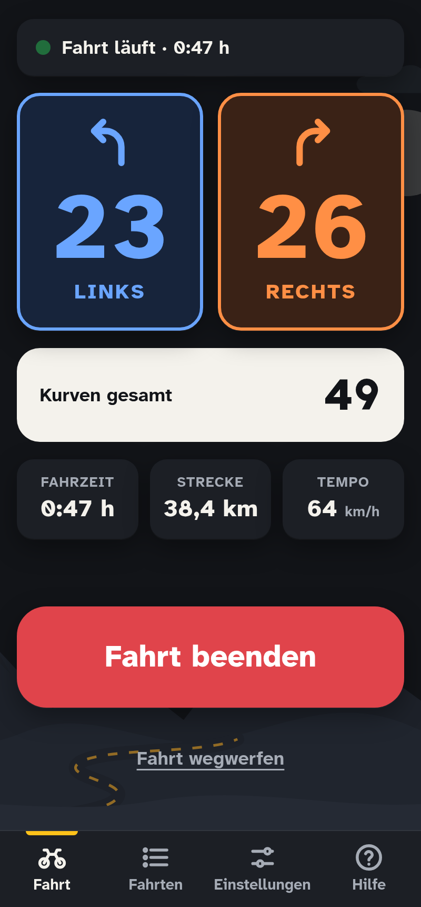
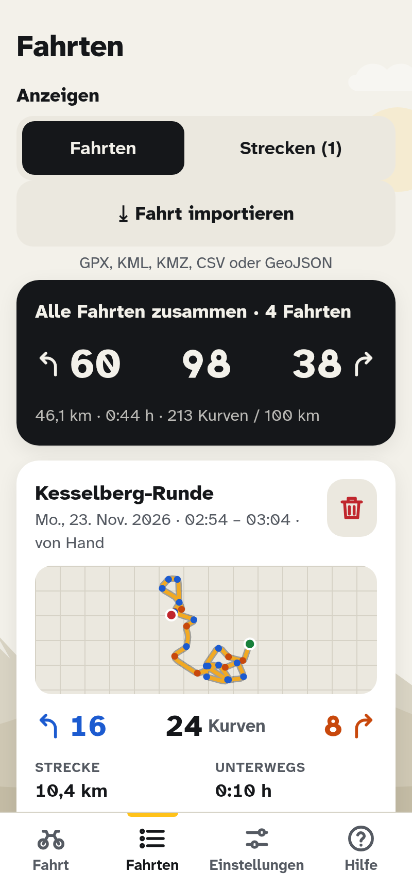
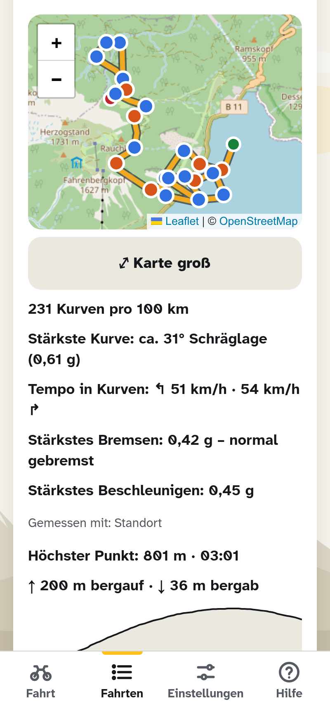
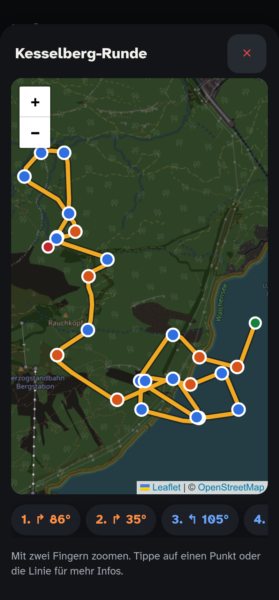
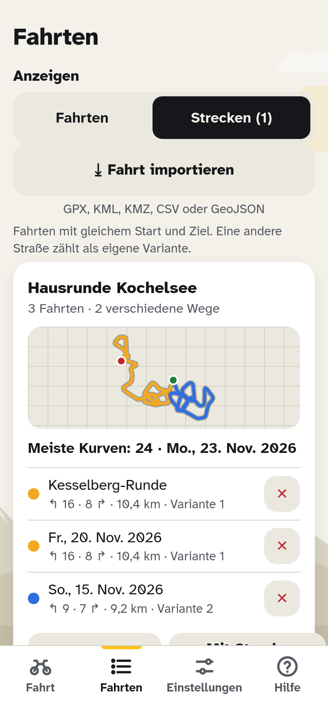
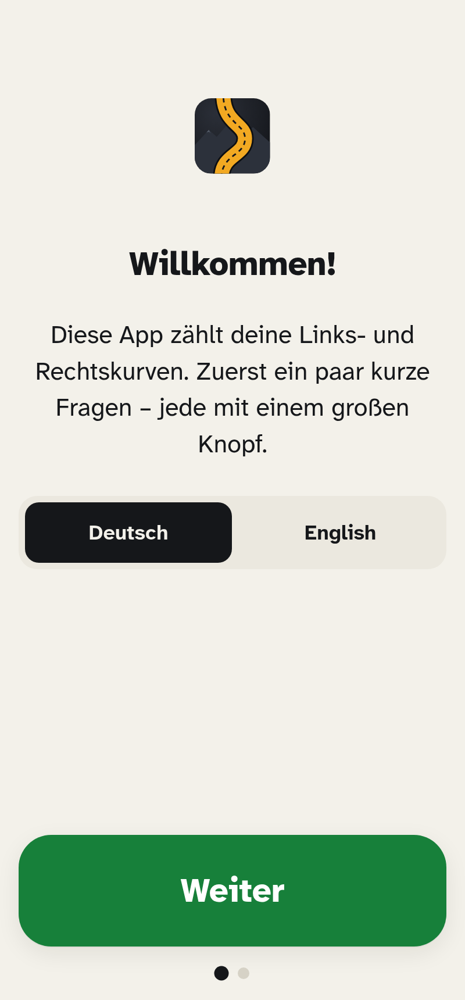
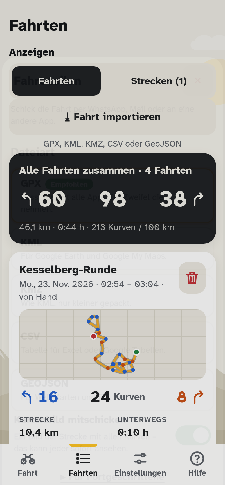
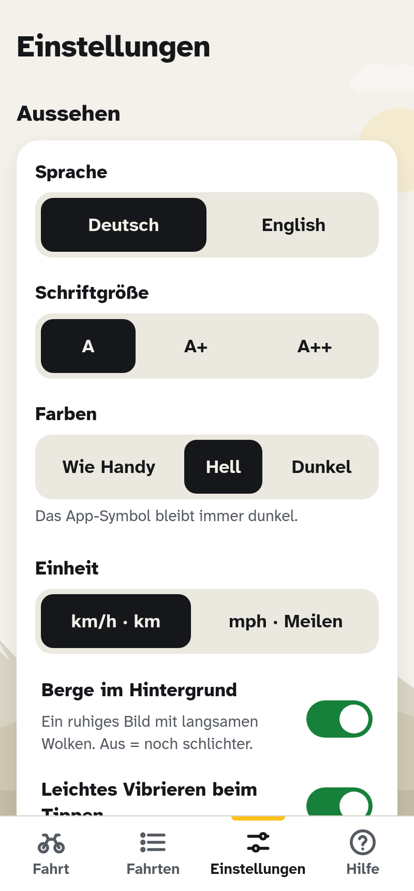
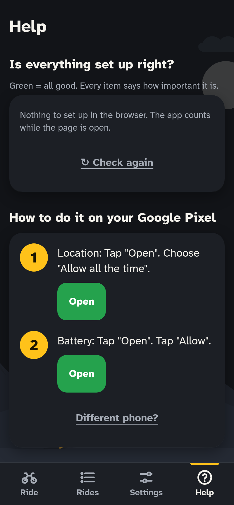
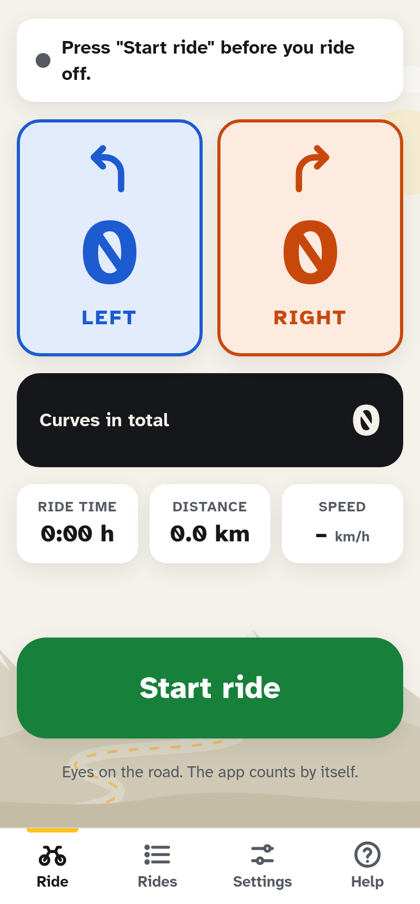

<h1 align="center">Curve Counter Simple</h1>

<p align="center">Counts your left and right curves on every ride – big buttons, plain words, phone anywhere.<br>
<i>Zählt deine Links- und Rechtskurven bei jeder Fahrt – große Knöpfe, einfache Worte, Handy egal wo.</i></p>

<p align="center">
  <a href="https://github.com/Master3307/curve-counter-simple/releases/latest"></a>
</p>

<p align="center">
  <a href="https://github.com/Master3307/curve-counter-simple/releases/latest"><b>⤓ Download for Android (APK)</b></a> ·
  <a href="#-iphone">iPhone</a> ·
  <a href="docs/curve-detection.md">How curves are counted</a>
</p>

<h2>📱・Screenshots</h2>

<p align="center">
  
  
  
  
  
</p>
<p align="center">
  
  
  
  
  
</p>

<sub>Screenshots use simulated sample rides and are made with <code>pnpm screenshots</code>.</sub>

<h2>🏍️・How it works</h2>

1. Press **Start ride**. Ride off – counting starts once you're actually rolling.
2. The app counts every curve: **↰ left**, **↱ right** and the **total**, plus time, distance and speed.
3. Press **Stop ride**. A summary shows your curves; the ride is checked once more and saved.

The phone can be anywhere: handlebar mount, tank bag, jacket pocket or flat on the dashboard.
Nothing to calibrate – the app learns in the background how the phone is lying.

<h2>✨・Features</h2>

- **Accurate curve detection** from three sources with different trust levels – GPS position,
  GPS direction of travel (Doppler) and the gyroscope as an "invisible compass" – fused, with a
  second check after every ride (lane changes, overtakes and bus bays don't count).
  Every curve gets a confidence: *sure*, *likely* or *unsure*. [Details and tuning →](docs/curve-detection.md)
- **Map** for every ride (OpenStreetMap): zoom, full screen, tap a curve or any point of the track
  for time, speed, height and distance there.
- **Routes**: rides with the same start and end are grouped automatically; another road becomes a
  *variant*. Merge rides and routes by hand – with a check (and a question) if start or end are apart.
- **Ride details**: curves per 100 km, strength classes, strongest curve with approx. lean angle,
  braking and acceleration, stops, height profile, measured tilt when the phone was mounted.
- **Files in and out**: GPX *(recommended)*, KML, KMZ, CSV, GeoJSON – export, import, "Open with" and
  "Share to". Extra data in files (heart rate, cadence, temperature, power, waypoints, description)
  is shown too.
- **Share** with the share sheet – with a rendered map picture, the file, or both; expert options to
  leave out curves, times, height or sensor data. Step-by-step guides for **Strava, Garmin Connect,
  Komoot, AllTrails, Google Maps (My Maps), Google Earth, Gaia GPS, Wahoo, Suunto, BMW Motorrad
  Connected, calimoto / Kurviger**.
- **Setup check** that says how important each setting really is (*must have*, *important*,
  *recommended*, *can stay off*), what happens if you skip it, and fixes it with one button. Before a
  ride the app warns if something important is missing. Guides for every major phone brand.
- **Battery modes**: accurate · normal · saver. **Smart watch**: the running ride on Wear OS.
- **Undo** for everything destructive. **Swipe** between tabs. German first, English one tap away.
  Text size, light / dark / like phone, calm animated mountain scenery (can be switched off).
- **Private**: no account, no ads, no tracking. Everything stays on the phone.

<h2>⤓・Install</h2>

**Android:** download `CurveCounterSimple-vX.Y.Z.apk` from the
[latest release](https://github.com/Master3307/curve-counter-simple/releases/latest), open it and allow
"install unknown apps" once. Updates install over it.

> Coming from the old **Simple Curve Counter** (v0.x)? That was a different app ID and key. Export your
> rides there (My rides → Save all as GPX), install Curve Counter Simple, import them, then uninstall the old one.

<h3 id="-iphone">iPhone</h3>

The iPhone build is distributed through **TestFlight** (invite link from the author). Until the
native iOS recorder exists, keep the app open while riding.

<h2>🧭・How curves are counted (short)</h2>

GPS positions are resampled every 10 m, the change of direction per step comes from position,
Doppler course and gyroscope, and a sliding window finds where turning starts and ends.
A curve is a change of direction of at least **20° / 30° / 45°** (setting), driven while moving;
S-bends are two curves, a roundabout or hairpin is one, wide motorway bends count from 45° and are
marked "wide". Saved rides are recounted automatically when the detector improves.
The full definition, the six real-world tuning changes (each with symptom, change and trade-off)
and the before/after on real rides are in **[docs/curve-detection.md](docs/curve-detection.md)**.

<h2>🤖・How this was made (AI)</h2>

Honest numbers: **practically all code, texts, graphics and docs in this repository were written by AI**
(Anthropic's Claude in Claude Code) – well over 95 %. The author did not write the code by hand.

What the author did: the idea, the product rules ("so simple that grandma gets it", "numbers must be
right"), **long and quite specific written instructions** for every version – lists of features,
UX wishes down to details (64 px buttons, swipe that's "not too sensitive", what the setup check must
explain), the curve-tuning criteria, recorded **real rides as GPX files with written descriptions of
what's wrong** (missed 90° bus corners, jitter at home, a suspected lane change) – plus testing on the
road and reviewing. The instructions said *what* and *why* in detail; *how* (algorithms, thresholds,
architecture) was left to the AI, which checked its curve detection against those rides on
OpenStreetMap before changing it.

<h2>🛠️・Development</h2>

Requirements: Node ≥ 22, pnpm, JDK 21 + Android SDK for the APK, macOS + Xcode for iOS.

```bash
pnpm install
pnpm dev           # in the browser (Settings → "Play a test ride")
pnpm test          # unit tests: detector, fusion, formats, routes, engine (app-kill rebuild) …
pnpm apk           # signed release APK → dist-apk/CurveCounterSimple-vX.Y.Z.apk
pnpm screenshots   # refresh docs/screenshots (headless Chromium)
pnpm icons         # app icons + splash from assets/
pnpm release minor # test, bump, tag, push → GitHub Actions builds APK + TestFlight
```

```
src/logic/     curves.ts (detector) · analyze.ts (after-ride check) · motion.ts · routes.ts ·
               gpx.ts · formats.ts (KML/KMZ/CSV/GeoJSON, zip) · height.ts · curveMetrics.ts …
src/tracking/  engine.ts · source.ts · fileIo.ts (share / import) · tracks.ts · plugin.ts
src/screens/   Ride · Rides (+ routes) · Settings · Help (+ about)
src/ui/        Map (Leaflet) · Share · SetupCheck · Onboarding · Scenery · mapImage …
src/guides/    phone-brand guides · app guides (send to / bring from)
android/…/tracking/  RecorderService (GPS + gyro + gravity, energy modes, watch notification) ·
               FixLog · SetupPlugin · InboxPlugin
```

Versioning: SemVer in `package.json`; Android `versionCode` / iOS build = `MAJOR*10000 + MINOR*100 + PATCH`.
Releases: tag `vX.Y.Z` → `release.yml` (signed APK on GitHub Releases) and `testflight.yml`
(needs the App Store Connect secrets). Signing key: `android/curvecountersimple-release.jks` +
`android/keystore.properties` (gitignored), uploaded with `scripts/upload-signing-secrets.sh`.

<h2>📜・Credits</h2>

Made by **Korbinian** ([MrKoby07](https://openuserjs.org/users/MrKoby07) · GitHub
[Master3307](https://github.com/Master3307)). Maps © [OpenStreetMap](https://www.openstreetmap.org/copyright)
contributors, map view by [Leaflet](https://leafletjs.com). Font: Atkinson Hyperlegible Next.

*Ride safely. Keep your eyes on the road – the app counts by itself.*
